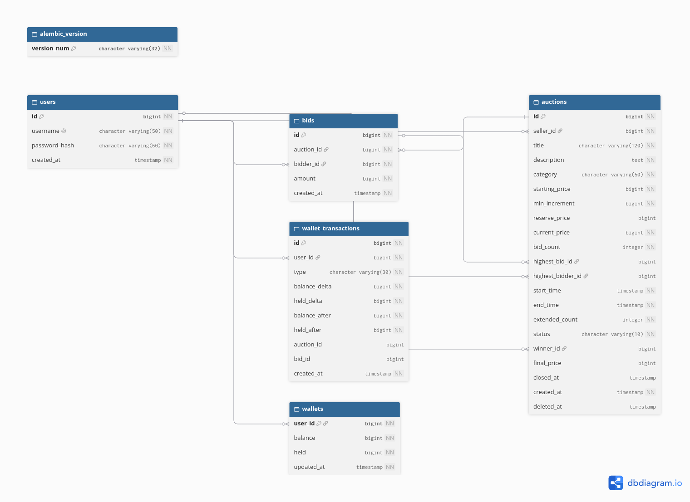

# NewBid88

## Mô tả bài toán

NewBid88 là hệ thống đấu giá trực tuyến, cho phép người dùng tạo phiên đấu giá sản phẩm của mình hoặc đặt giá vào phiên của người khác.

Mỗi phiên có thông tin sản phẩm, giá khởi điểm, bước tăng giá tối thiểu và thời gian diễn ra. Trong thời gian hoạt động, hệ thống tiếp nhận các lượt đặt giá hợp lệ và cập nhật giá cao nhất hiện tại của sản phẩm.

- Người dùng không tạo tài khoản có thể xem danh sách các phiên đấu giá hiện tại, theo dõi phiên đấu giá với thông tin sản phẩm, người bán, giá khởi điểm,… Thông tin người đặt giá được hiển thị dưới dạng `abc***` để bảo mật.
- Người dùng tạo tài khoản có thêm chức năng tham gia, mở phiên đấu giá sản phẩm, quản lý thông tin cá nhân và lưu các phiên đã tham gia.

Hệ thống cung cấp ví tiền để quản lý số dư, tiền tạm giữ và tiền khả dụng. Khi người dùng dẫn đầu, số tiền tương ứng với mức giá đã đặt được tạm giữ. Khi bị người khác vượt giá, khoản tiền tạm giữ của lượt đặt trước được hoàn trả.

## Các nghiệp vụ cơ bản

### Quản lý tài khoản

- Người dùng đăng ký tài khoản, tên đăng nhập phải là duy nhất
- Khi đăng nhập bằng tài khoản đăng ký, hệ thống sẽ cấp token để sử dụng các chức năng của người dùng tạo tài khoản.

### Tạo phiên đấu giá

- Người dùng tạo tài khoản được tạo phiên đấu giá với các thông tin bắt buộc và không bắt buộc.

### Tra cứu phiên đấu giá

- Mọi người dùng đều tra cứu được các phiên đấu giá đã và đang xảy ra, với người đã đăng nhập, có thể dễ dàng hơn trong việc tìm kiếm các phiên đấu giá của chính người đăng nhập.

### Xóa phiên đấu giá

- Người dùng tạo tài khoản có thể xóa phiên đấu giá do mình tạo ra khi đáp ứng các điều kiện như: phiên chưa bị xóa, chưa có lượt đặt giá, phiên có trạng thái mở và chưa đến thời gian kết thúc.

### Quản lý ví

- Người dùng tạo tài khoản có chức năng quản lý ví của mình với các thông tin như: tổng số dư, số tiền đang tạm giữ khi tham gia đấu giá và số tiền khả dụng.
- Khi có các giao dịch sẽ lưu lại lịch sử giao dịch.

### Đặt giá

- Người dùng tạo tài khoản được tham gia đặt giá trong các phiên đấu giá với điều kiện như: phiên đấu giá chưa bị xóa, có trạng thái mở, trong thời gian cho phép đặt giá, không phải người bán, không phải người đã đang dẫn đầu trong phiên đấu giá hiện tại, đáp ứng các quy tắc giá tối thiểu và đủ tiền khả dụng.

### Cập nhật dữ liệu sau khi đặt giá và gia hạn phiên đấu giá

- Sau khi đặt giá, cập nhật lại bảng đấu giá, tạm giữ tiền của người dẫn đầu, nếu có người đặt giá cao hơn thì hoàn trả và cập nhật lại.
- Mỗi khi có lượt đặt giá hợp lệ trong 60s cuối, hệ thống sẽ cập nhật thời gian kết thúc mới – coi như là gia hạn tiếp phiên đấu giá thêm 1 lượt và tiếp diễn.

## Quy trình hoạt động

1. **Đăng ký, đăng nhập:** tạo tài khoản kèm ví; nhận JWT để dùng các API cần xác thực.
2. **Tạo hoặc chọn phiên:** người bán tạo phiên; người mua tra cứu và nạp đủ tiền vào ví.
3. **Đặt giá:** phiên phải còn mở, chưa bị xóa và trong thời gian cho phép; người đặt không phải người bán hoặc người đang dẫn đầu. Giá đầu tiên tối thiểu bằng giá khởi điểm; các lượt sau tối thiểu bằng giá hiện tại cộng bước tăng giá.
4. **Cập nhật:** tạm giữ tiền của người dẫn đầu mới, giải phóng tiền người dẫn đầu cũ, lưu lịch sử và cập nhật phiên trong cùng transaction. Mặc định, lượt hợp lệ trong 60 giây cuối đưa hạn kết thúc tới ít nhất 60 giây sau thời điểm đặt giá.
5. **Theo dõi:** tra cứu giá hiện tại, lịch sử đặt giá và ví; khi hết thời gian, phiên không nhận thêm lượt đặt giá.

## Luồng xử lý API

1. **Middleware:** kiểm tra JWT với các endpoint cần đăng nhập.
2. **Router / schema:** nhận HTTP request, kiểm tra dữ liệu bằng Pydantic.
3. **Service / domain:** xử lý nghiệp vụ và kiểm tra quy tắc đấu giá.
4. **Unit of Work / repository:** truy cập PostgreSQL qua SQLAlchemy; khóa phiên và ví khi đặt giá, commit khi thành công hoặc rollback phần chưa commit.
5. **Response:** trả JSON và mã HTTP; lỗi được chuẩn hóa qua error handler.

## Đặc tả API

Nằm trong `/docs` của mã nguồn.

[docs/api_spec.json](docs/api_spec.json)

## Tech stack

- Ngôn ngữ: Python 3.12
- Framework: FastAPI
- Cơ sở dữ liệu: PostgreSQL 16

| Thư viện / Công cụ | Vai trò |
| --- | --- |
| Uvicorn | Chạy ứng dụng FastAPI, tiếp nhận và xử lý yêu cầu HTTP. |
| Pydantic | Định nghĩa schema, kiểm tra dữ liệu đầu vào và chuẩn hóa dữ liệu đầu ra. |
| Pydantic Settings | Đọc và kiểm tra cấu hình từ biến môi trường và file .env. |
| SQLAlchemy | Ánh xạ các bảng thành đối tượng Python, truy vấn dữ liệu và quản lý transaction. |
| Psycopg | Kết nối và trao đổi dữ liệu với PostgreSQL. |
| Alembic | Quản lý migration, tạo và cập nhật cấu trúc cơ sở dữ liệu. |
| PyJWT | Tạo và xác minh token JWT để xác thực người dùng. |
| bcrypt | Băm mật khẩu và kiểm tra mật khẩu khi đăng nhập. |
| pytest | Viết và chạy các bài kiểm thử tự động. |
| HTTPX | Hỗ trợ gửi yêu cầu HTTP trong kiểm thử API thông qua TestClient. |
| Docker | Đóng gói ứng dụng và môi trường chạy bằng container. |
| Docker Compose | Cấu hình và chạy các dịch vụ API, PostgreSQL cùng nhau. |

## Database

## Vấn đề hiện tại

- Số lượng bid lớn: Khi một lượng lớn số người bid một lúc, số tiền bid của của nhiều người sẽ bị một người vượt qua và nhận thông báo “giá đã vượt qua” -> chờ vô ích.
- Hệ thống bị chậm khi rất nhiều đăng nhập cùng một lúc.
- Nhiều người tải lại phiên liên tục để xem giá mới. Mỗi lần tải đều hỏi database dù giá chưa đổi, nên database quá tải.
- Một người muốn giữ vị trí dẫn đầu dùng script hoặc nhiều tab tải lại phiên liên tục. Phiên đó chậm hẳn, người khác khó bid kịp.
- Tiền hoặc phiên bid có thể bị nhân đôi nếu bấm lại khi mạng chập chờn : nạp 5 triệu, app báo lỗi hết thời gian chờ, người dùng bấm lại và ví bị cộng 10 triệu. Tạo phiên cũng bị nhân đôi theo cách này.
